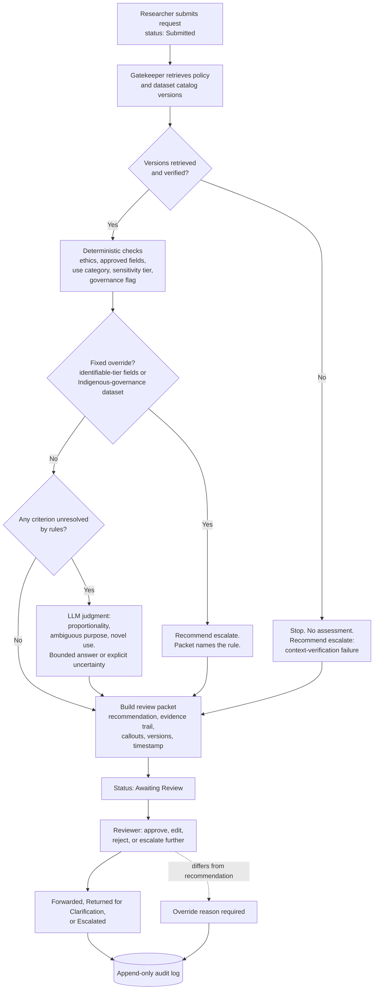
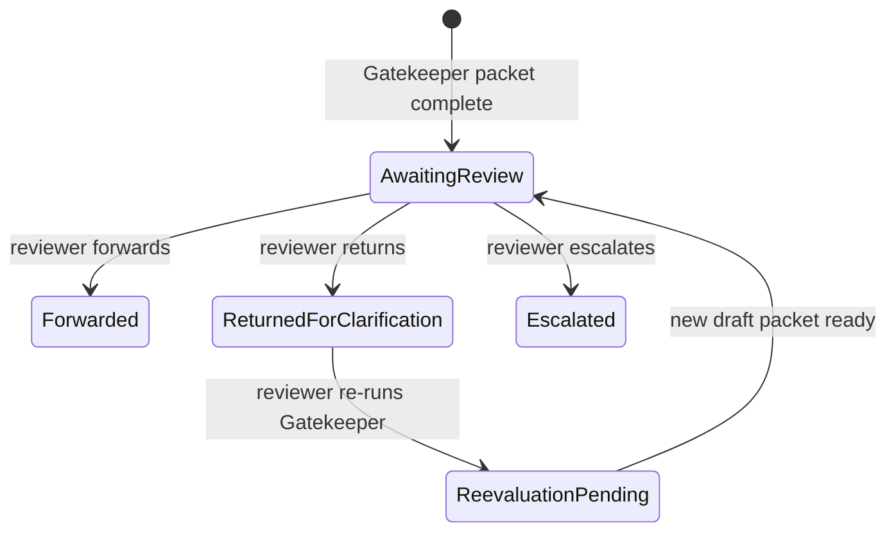

# Architecture

High-level design of the Gatekeeper prototype. All components work on synthetic data.

## Request flow

## Request statuses

Five statuses. There is no "rejected" or "denied" status, because only the committee can approve or deny access.

"Reject" is a reviewer action in the interface that rejects Gatekeeper's recommendation, not the researcher's request. The reviewer then chooses one of the three routes.

## Components

| Component | Role |
|---|---|
| Versioned policy and dataset catalog | Synthetic files that stand in for the trust's rules and datasets. Each carries a version identifier. |
| Deterministic checker | Plain rules, no model call. Retrieves and verifies versions, runs the checkable criteria and the two fixed overrides. |
| LLM judgment layer | Runs only for criteria the checker cannot resolve. Returns a bounded judgment with evidence, or explicit uncertainty. |
| Review packet renderer | One fixed template for every request. Reuses results already computed and runs no second assessment. |
| Reviewer interface | Queue, split-view case page, decision card. Every control is real and working. |
| Audit log | Append-only. Records inputs, versions, check results, model reasoning, packet, status changes, reviewer action, and any override reason. |

## Memory

Memory is scoped to a single request: which criteria passed, failed, or remain unresolved. After a clarification, Gatekeeper re-checks only the unresolved criteria and shows what changed. The audit log is for human retrieval and is never used as context for another request. No researcher or institution history is used.

## Boundaries

Gatekeeper cannot grant, deny, or finalise access, send anything to a researcher, forward a request, change the policy or catalog, or judge Indigenous governance authorization. Every output is a draft for the reviewer.
